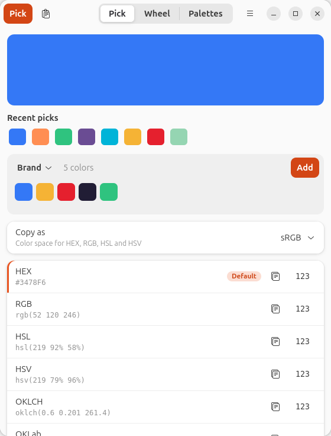
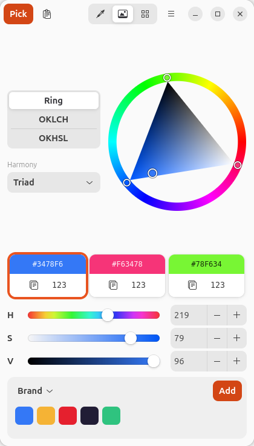
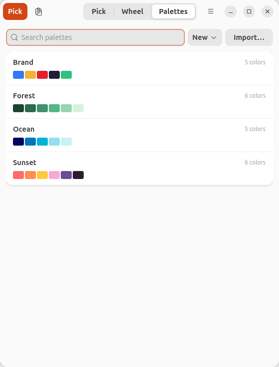

# Colorz

A color picker for the GNOME tray, written in Rust with GTK4 and libadwaita.
Pick any pixel on screen with the system picker, see and copy the color in the
format you need, fine-tune it on a color wheel, and keep named palettes.

| Pick | Wheel | Palettes |
|------|-------|----------|
|  |  |  |
| Pick from the screen (Super+Shift+C, the tray or the Pick button). The color shows in every format, each with a copy button; recent picks and the active palette sit right below. | Fine-tune on a ring, OKLCH or OKHSL wheel, or with the sliders. Choose a harmony to get matching colors, each with its own card to copy, and add them to a palette in one click. | Keep named palettes, search them, build them from an image, and import or export CSS variables and GIMP `.gpl` files. |

## Download

[**Download the latest .deb**](https://github.com/partty/Colorz/releases/latest/download/colorz_amd64.deb)
(Ubuntu 26.04 or newer, x86-64), or browse all
[releases](https://github.com/partty/Colorz/releases). Install it with:

```
sudo apt install ./colorz_amd64.deb
```

For the tray icon, keep the "Ubuntu AppIndicators" extension enabled (it is on
by default on Ubuntu).

## Features

- Screen picking through the XDG Screenshot portal (Wayland-friendly), from a
  global shortcut, the tray menu, or `colorz --pick`.
- Copyable formats: HEX, RGB, HSL, HSV, OKLCH, OKLab, `color()`.
- "Copy as" color management: sRGB, Display P3, Adobe RGB (1998), or a custom
  ICC profile.
- Optional Chrome correction for picks taken from Chrome.
- Color wheel (including a ring mode) with per-channel sliders and
  harmonies (complementary, analogous, triad, split-complementary): each
  harmony color gets a card to copy, and Add adds them all.
- Palettes with labels and CSS variable names; CSS and GIMP `.gpl`
  import/export; palette extraction from an image.
- Palette bar on the Pick and Wheel tabs: add the current color to the
  active palette in one click, edit a palette color on the wheel, or replace
  it with a screen pick.
- Pick history, paste-to-parse, drag and drop.
- Tray icon, desktop notifications, autostart (on by default).

## Requirements

- Ubuntu / GNOME 50 on Wayland (developed and verified on Ubuntu 26.04,
  GTK 4.22, libadwaita 1.9, lcms2 2.17).
- The AppIndicator / StatusNotifierItem GNOME extension for the tray icon
  (Ubuntu ships "Ubuntu AppIndicators").
- Build dependencies:

  ```
  sudo apt install libgtk-4-dev libadwaita-1-dev liblcms2-dev
  ```

  These bring `glib-compile-resources`, which bundles the app icon into the
  binary so it also shows when running from `target/`.

- Rust via [rustup](https://rustup.rs). The Makefile expects cargo at
  `~/.cargo/bin/cargo` (override with `make CARGO=...`).

## Build, test, install

```
make build       # cargo build --release
make test        # cargo test --workspace
make lint        # clippy -D warnings + fmt --check
make deb         # Debian package in target/debian (needs cargo-deb)
make install     # build, then install under PREFIX (default ~/.local)
make uninstall
```

`make install` puts the binary in `~/.local/bin/colorz`, the desktop file in
`~/.local/share/applications`, and the icon in
`~/.local/share/icons/hicolor/scalable/apps`. Make sure `~/.local/bin` is on
your `PATH`. Use `make install PREFIX=/usr/local` (with suitable permissions)
for another location.

### Debian package

`make deb` builds `target/debian/colorz_<version>-1_amd64.deb` with
[cargo-deb](https://github.com/kornelski/cargo-deb)
(`cargo install cargo-deb`). It installs to `/usr` and depends on the
libraries it was built against, so build it on the Ubuntu release you
target. Install it with `sudo apt install ./target/debian/colorz_*.deb`.

GitHub Actions runs format, lint and tests on every push and pull request,
and builds the `.deb` on Ubuntu 26.04 (download it from the run's
artifacts). Pushing a tag `v<version>` matching the `Cargo.toml` version
also attaches the `.deb` to a GitHub release.

Install before relying on the global shortcut or notifications: both need the
installed `.desktop` file (app ID `io.github.partty.Colorz`).

## Usage

- Default global shortcut: Super+Shift+C. GNOME asks you to confirm it the
  first time it is registered.
- `colorz` starts the app (or presents the running instance).
- `colorz --pick` starts a pick in the running instance.
- `colorz --background` starts hidden in the tray (used by autostart).
- An installed build sets up the autostart entry
  (`~/.config/autostart/io.github.partty.Colorz.desktop`) once, according to
  Settings → Start at login (on by default); after that only that toggle
  changes it. Runs from `target/` never touch autostart.

Keys:

- Ctrl+V: paste a color
- Ctrl+,: settings
- Ctrl+Q: quit
- On the wheel:
  - Arrow keys nudge (Shift for x10). In ring mode Left/Right change
    saturation and Up/Down value.
  - Page Up/Down turn the hue.
  - Shift+drag for fine control.

### Formats

Shown for `#3478F6`. Each row can be copied with or without the function
wrapper.

| Format  | With wrapper                        | Bare                    |
|---------|-------------------------------------|-------------------------|
| HEX     | `#3478F6`                           | `3478F6`                |
| RGB     | `rgb(52 120 246)`                   | `52 120 246`            |
| HSL     | `hsl(219 92% 58%)`                  | `219 92% 58%`           |
| HSV     | `hsv(219 79% 96%)`                  | `219 79% 96%`           |
| OKLCH   | `oklch(0.6 0.201 261.4)`            | `0.6 0.201 261.4`       |
| OKLab   | `oklab(0.6 -0.03 -0.199)`           | `0.6 -0.03 -0.199`      |
| color() | `color(display-p3 0.2753 0.4646 0.9325)` | `0.2753 0.4646 0.9325` |

The legacy comma syntax (`rgb(52, 120, 246)`, `52, 120, 246`) is accepted when
parsing.

The table uses the default precision. Settings → Formats → Decimal places
(2–9, default 3) sets the decimals for OKLCH and OKLab; the other fractional
numbers move with it: OKLCH hue gets two fewer, HSL/HSV three fewer, `color()`
one more. HEX and RGB stay whole bytes. At 3 decimals, copying a color and
pasting it back can shift an 8-bit channel by a few units for edge colors
(bright cyans and greens); from 4 decimals on, every format returns within ±1.

Paste accepts hex with or without `#`, any CSS color syntax, and Colorz's own
numbers-only output. Bare numbers are interpreted in your default format first.

### Copy as

"Copy as" converts the color to a target space before it goes to the clipboard:
sRGB, Display P3, Adobe RGB (1998), or a custom ICC profile (RGB profiles).
Conversion uses relative colorimetric intent without black point compensation.
It applies to clipboard text for HEX, RGB, HSL and HSV; `color()` uses the
target's CSS name. Whenever the target is not sRGB, a badge with its name sits
next to every value it changes (Pick and Wheel tabs, palette rows, image
swatches), and a warning icon marks values that had to be mapped into the
target's gamut. It never alters palette files: CSS and GPL export and "Copy
All as Hex List" are always sRGB. Example: `#3478F6` copied as Adobe RGB is
`#5077F2`.

A custom ICC profile has no CSS name, so `color()` is unavailable with it; if
`color()` is your default format, default-format copies (shortcut, tray,
palette rows) use HEX instead.

Limitation: LUT-based destination ICC profiles clip silently (no out-of-gamut
warning). Matrix/shaper profiles are fine.

### Chrome correction

Off by default. Chrome renders sRGB with a plain gamma 2.2 curve, so a pick
from Chrome can differ slightly from the source value. When enabled, picks are
decoded with gamma 2.2 and re-encoded with the sRGB curve, e.g. a picked
(55, 119, 246) becomes `#3478F6`.

### Palettes

- Each color has a label and a CSS variable name.
- CSS export/import uses `--name: value; /* label */`; unnamed colors become
  `--color-N`. Import as a new palette or merge by name (merging never
  deletes). If a file has several blocks you choose which to import. Export
  offers every format that is valid CSS (all but HSV).
- GIMP `.gpl` import and export.
- Palette from image: deterministic k-means in OKLab, honours embedded ICC
  profiles and EXIF orientation, 3 to 16 colors.

### Building palettes

The palette bar (Pick tab below the recent picks, Wheel tab below the sliders)
shows the active palette: its name, one chip per color, and an Add button.

- Add adds the current color; on the Wheel tab with a harmony chosen, it adds
  every harmony color. The name menu switches palettes or creates one ("New
  palette…"). With no palette yet, Add asks for a name and creates one. A long
  palette scrolls sideways, also with the mouse wheel.
- "Add every pick" (in the name menu) appends each successful screen pick to
  the active palette. While it is on, the bar shows an "Auto-add" badge and
  the menu item reads "Stop adding every pick".
- Click a chip to edit that color on the wheel; the chip gets an outline and
  previews your changes. Save (next to Add, shown only while editing) writes
  the current color back in place (label and variable name are kept). Click
  the same chip again, or another chip, to drop the edit without saving.
  Picks made meanwhile change the edited color, and Add becomes "Add as
  new".
- Palette view: each row has "Edit on wheel" and "Pick replacement" (the next
  screen pick replaces that color). The header has "Pick into" (the next pick
  is appended and the palette becomes active) and "Open on wheel".
- Adds, replaces and pick-intos show a toast with Undo. Undo is only applied if
  the palette still looks the way the action left it; otherwise "Can't undo:
  the palette has changed" is shown. Outside the window, the result is a
  notification without Undo.

### Storage

| Path                                          | Contents            |
|-----------------------------------------------|---------------------|
| `~/.config/colorz/config.toml`                | settings            |
| `~/.local/share/colorz/palettes/<id>.json`    | one file per palette|
| `~/.local/share/colorz/history.json`          | pick history        |

Writes are atomic. A corrupt `config.toml` is moved to `config.toml.bak`;
corrupt palette files are skipped and left untouched.

## Project layout

```
colorz-core/src   GUI-free library: color math, formats, parsing, ICC, CSS/GPL,
                  palette extraction, storage
colorz/src        GTK4/libadwaita app
  app.rs, state.rs, main.rs   application, actions, shared state
  platform/       pick (portal), shortcuts, tray, clipboard, notify, autostart
  ui/             window, pick page, wheel page, palettes page, settings, dialogs
data/             desktop file, icon, AppStream metainfo, icon resource list
docs/screenshots  README screenshots
.github/          CI: tests and the .deb build, releases on tags
Makefile
```

## Status / not yet verified on a real session

Unit tests cover the core and the app's pure helpers (`make test`), and the UI
was rendered headlessly, but these need manual testing on a real desktop
session:

- Picking through the portal
- The Wayland clipboard focus trick
- Tray menu
- Global shortcut confirmation
- Notifications
- Drag and drop
- Crispness under fractional scaling
- Picks from Firefox (untested)

## Troubleshooting

- No tray icon: install and enable the AppIndicator extension (on Ubuntu,
  "Ubuntu AppIndicators"), or use any StatusNotifierItem host.
- Global shortcut does nothing: run `make install` first. The GlobalShortcuts
  portal needs the installed `.desktop` file; from a dev run it answers "App
  info not found for 'io.github.partty.Colorz'". Also confirm the GNOME prompt. As
  a fallback enable Settings, General, "Use GNOME keyboard shortcut instead",
  which creates a GNOME custom keybinding running `colorz --pick`.
- No notifications: same cause, install first.
- Clipboard on Wayland: with no focused Colorz window, copying briefly maps a
  tiny window to gain focus, and falls back to briefly showing the main window.
  Run with `COLORZ_DEBUG=1` to print which path was used.
- Dev snapshots: `COLORZ_DEBUG_SNAPSHOT=<dir>` renders the pick, wheel and
  palettes pages to PNG and quits (optionally with
  `COLORZ_DEBUG_SNAPSHOT_IMAGE=<file>` and `COLORZ_DEBUG_SNAPSHOT_DIALOGS=1`).

## License

Copyright (C) 2026 Ogi Tsonev

Colorz is free software: you can redistribute it and/or modify it under the
terms of the GNU General Public License as published by the Free Software
Foundation, either version 3 of the License, or (at your option) any later
version.

Colorz is distributed in the hope that it will be useful, but WITHOUT ANY
WARRANTY; without even the implied warranty of MERCHANTABILITY or FITNESS FOR A
PARTICULAR PURPOSE. See the GNU General Public License for more details.

The full license text is in [LICENSE](LICENSE).
